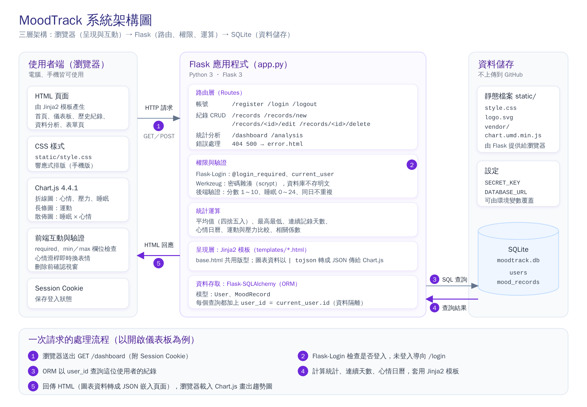
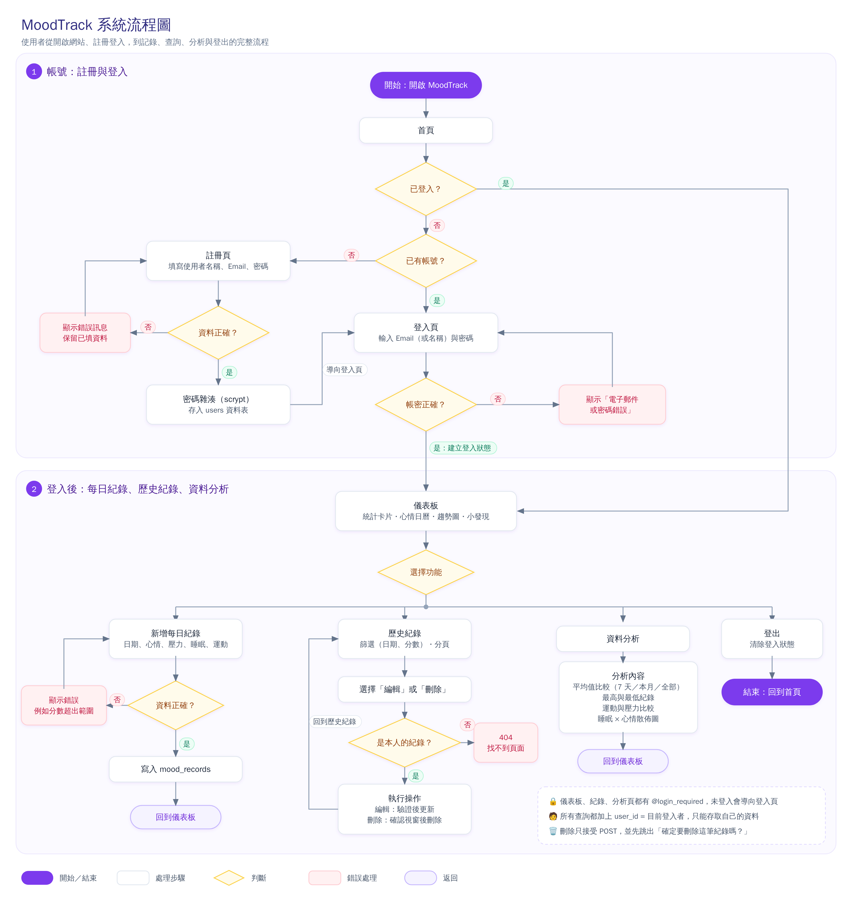
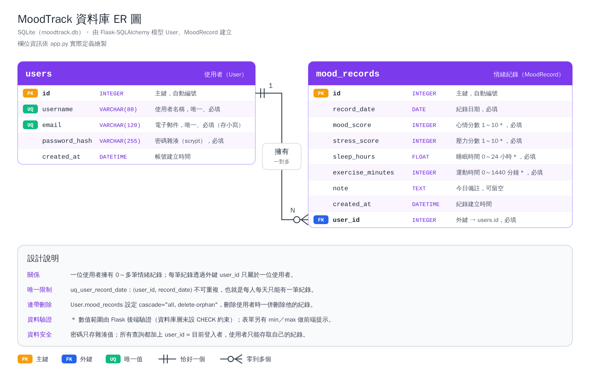

# MoodTrack（python_FP）

MoodTrack 是一套使用 Flask 開發的**個人情緒與壓力紀錄分析平台**（程式設計 Python 課程期末專案）。
每天花 30 秒記下心情、壓力、睡眠與運動，系統會用統計與圖表幫你看見自己的生活模式。

## 目前功能

- 使用者註冊、登入、登出，密碼以雜湊儲存
- 新增、查看、編輯、刪除每日情緒紀錄（完整 CRUD），每人每天一筆
- 歷史紀錄：日期／分數篩選、分頁
- 儀表板：心情日曆（最近 5 週，顏色深淺代表心情）、連續記錄天數、最近 7／30／90 天統計卡片、心情與壓力趨勢圖、睡眠趨勢圖、運動長條圖、小發現
- 資料分析：不同期間平均、最高最低紀錄、運動與壓力比較、睡眠與心情散佈圖
- 權限控制：每位使用者只能看到、編輯、刪除自己的資料
- 響應式介面（手機可用）、自訂錯誤頁面
- 35 項自動化測試 + 33 項瀏覽器端到端測試（見 [TESTING.md](TESTING.md)）

## 使用技術

| 類別 | 技術 |
| --- | --- |
| 後端 | Python 3、Flask 3 |
| 資料庫 | SQLite、Flask-SQLAlchemy（ORM） |
| 使用者認證 | Flask-Login、Werkzeug 密碼雜湊（scrypt）、Flask-WTF（CSRF 保護） |
| 前端 | Jinja2 模板、HTML、CSS（自訂樣式，含手機版排版） |
| 資料視覺化 | Chart.js 4.4.1（放在本機 `static/vendor/`） |
| 測試 | Python 內建 `unittest` |

## 專題報告

[`docs/report/MoodTrack_期末專題報告.docx`](docs/report/MoodTrack_期末專題報告.docx)：共 15 章，含系統架構圖、流程圖、ER 圖、網站截圖與測試結果。

## 系統架構



## 系統流程



## 資料庫設計（ER 圖）



圖檔在 `docs/diagrams/`：`.png` 可直接貼進報告，`.svg` 放大不失真、可用瀏覽器或繪圖軟體開啟修改。

## 安全設計

| 項目 | 做法 |
| --- | --- |
| 密碼 | 只存 `generate_password_hash` 產生的雜湊，資料庫裡沒有明文密碼 |
| 登入權限 | 儀表板、紀錄、分析頁都加上 `@login_required` |
| 資料隔離 | 所有查詢都加上 `user_id=current_user.id`；改網址存取別人的紀錄會得到 404 |
| 刪除 | 只接受 POST，並在刪除前跳出確認視窗；不能用開網址的方式刪除 |
| CSRF | Flask-WTF `CSRFProtect`：所有表單都帶 `csrf_token`，其他網站無法冒用登入狀態送出表單 |
| Cookie | `HttpOnly`、`SameSite=Lax`；部署在 HTTPS 時加上 `Secure` |
| 登入導向 | `next` 參數只允許站內路徑，避免被導到外部網站 |
| 機密檔案 | `moodtrack.db`、`venv/`、`.env` 都在 `.gitignore`，不會上傳到 GitHub |
| 金鑰 | `SECRET_KEY` 可用環境變數覆蓋；正式部署時不要使用程式中的預設值 |

## 開發進度

### 第一階段：最小可執行版本 ✅
- [x] Flask 網站可以啟動、首頁可以顯示
- [x] SQLite 資料庫自動建立（專案根目錄的 `moodtrack.db`）
- [x] 專案提交到 GitHub

### 第二階段：使用者系統與每日紀錄 ✅
- [x] `User`、`MoodRecord` 資料模型
- [x] 註冊（帳號、電子郵件、密碼，註冊後導向登入頁）、登入（以電子郵件登入，也接受使用者名稱，可勾「記住我」）、登出
- [x] 只有登入的使用者可以進入儀表板
- [x] 新增每日情緒紀錄（`/records/new`）：日期、心情（1～10，表情隨分數變化）、壓力（1～10）、睡眠時間、運動時間、備註
  - 每人每天一筆，同一天重複新增會被擋下；可補記過去日期，不能選未來日期
  - 欄位驗證：心情／壓力 1～10、睡眠 0～24 小時、運動 0～1440 分鐘，錯誤時保留已填資料
- [x] 編輯（`/records/<id>/edit`）與刪除自己的紀錄
- [x] 歷史情緒紀錄列表（`/records`）：只顯示自己的紀錄、依日期由新到舊，手機上改為卡片排版

### 第三階段：儀表板統計與圖表 ✅
- [x] 統計卡片：總紀錄天數、最近 N 天有紀錄天數、平均心情／壓力／睡眠、運動總計（預設最近 7 天，可切換 7／30／90 天）
- [x] Chart.js 圖表：心情與壓力趨勢（同一 1～10 量尺）、睡眠趨勢（含 7 小時參考線）、運動時間長條圖
  - 沒有紀錄的日子以虛線連接，不假造資料；滑鼠移上去可看當天數值
  - 每個指標固定一個顏色（色盲安全配色），所有圖表一致
- [x] 小發現：比較「睡滿 7 小時／有運動」與否的日子平均心情（僅供參考，不代表因果）
- [x] 最近一筆紀錄
- Chart.js 4.4.1 放在 `static/vendor/`，不依賴外部 CDN，沒有網路也能顯示

### 第四階段：資料分析強化 ✅
- [x] 資料分析頁（`/analysis`）：最近 7 天／本月／全部紀錄的平均值比較
- [x] 最高與最低紀錄：心情最高／最低、壓力最高、睡眠最長／最短的一天
- [x] 運動與壓力比較：有運動 vs 沒運動日子的平均壓力（註明不代表因果）
- [x] 睡眠與心情散佈圖，附皮爾森相關係數
- [x] 歷史紀錄篩選：開始／結束日期、最低心情、最低／最高壓力

## 資料模型

| 資料表 | 欄位 |
| --- | --- |
| `users`（`User`） | `id` PK、`username`（唯一）、`email`（唯一）、`password_hash`（只存雜湊）、`created_at` |
| `mood_records`（`MoodRecord`） | `id` PK、`record_date`、`mood_score`（1～10）、`stress_score`（1～10）、`sleep_hours`、`exercise_minutes`、`note`、`created_at`、`user_id` FK（`user_id` + `record_date` 唯一） |

一位使用者擁有多筆情緒紀錄（`User.mood_records`），刪除使用者時會一併刪除其紀錄。

> 從舊版升級時，如果 `moodtrack.db` 裡沒有重要資料，直接刪掉它再執行 `python app.py` 重建即可；
> `db.create_all()` 只會建立不存在的資料表，不會修改已存在的資料表結構。

## 環境需求

- Python 3.10 以上

## 快速開始（PowerShell）

```powershell
python -m venv venv
.\venv\Scripts\Activate.ps1
pip install -r requirements.txt
python app.py
```

打開瀏覽器到 <http://127.0.0.1:5000> 就能看到首頁。

> 啟用虛擬環境遇到執行原則錯誤，先執行
> `Set-ExecutionPolicy -Scope Process -ExecutionPolicy Bypass` 再重新啟用。

## 專案結構

```
python_FP/
├── app.py               # Flask 主程式：設定、資料模型、路由
├── requirements.txt     # 套件清單（pip install -r 安裝）
├── README.md            # 專案說明
├── TESTING.md           # 測試紀錄
├── DEPLOY.md            # PythonAnywhere 部署教學
├── docs/diagrams/       # 系統架構圖、系統流程圖、ER 圖（PNG + SVG）
├── docs/report/         # 期末專題報告（Word）
├── tests/
│   └── test_app.py      # 自動化測試（35 項）
├── templates/
│   ├── base.html        # 共用版型（導覽列、提示訊息）
│   ├── index.html       # 首頁
│   ├── register.html    # 註冊
│   ├── login.html       # 登入
│   ├── dashboard.html   # 儀表板：今日狀態、最近紀錄
│   ├── records.html     # 歷史情緒紀錄列表（含篩選）
│   ├── analysis.html    # 資料分析
│   ├── record_form.html # 新增／編輯每日情緒紀錄
│   └── error.html       # 404／500 錯誤頁
├── static/
│   ├── style.css        # 樣式
│   ├── logo.svg         # Logo 與網頁圖示
│   └── vendor/          # Chart.js（MIT 授權）
├── moodtrack.db         # 執行後自動產生的 SQLite 資料庫（不提交）
└── venv/                # 虛擬環境（不提交）
```

## 部署到網路上

照 [DEPLOY.md](DEPLOY.md) 的步驟部署到 PythonAnywhere（有免費方案），就會有一個公開網址可以分享。

## 執行測試

```powershell
python -m unittest -v
```

測試使用暫時的資料庫，不會影響 `moodtrack.db`。測試項目與結果見 [TESTING.md](TESTING.md)。

## Demo 流程（3～5 分鐘）

1. 開啟 MoodTrack 首頁
2. 註冊帳號 → 登入
3. 新增 2～3 筆紀錄（可補記前幾天）
4. 開啟歷史紀錄，示範篩選（例如壓力 7 分以上）
5. 編輯一筆紀錄
6. 回到儀表板：平均心情與壓力、趨勢圖、切換 7／30 天
7. 開啟資料分析：最高最低、運動與壓力、睡眠與心情散佈圖
8. 登出，切換另一個帳號，展示看不到前一個人的資料
9. 說明系統限制與未來方向

## 系統限制

- 資料依賴使用者主動輸入，漏記的日子不會有資料
- 分析結果只反映紀錄中的趨勢，相關不等於因果
- **不代表醫療診斷結果**
- 目前只分析個人資料，沒有群體比較
- 紀錄天數少時，統計結果可能不穩定
- 目前沒有雲端部署或多人協作功能

## 未來改進方向

- 匯出資料（CSV）
- 深色模式
- 每日提醒
- 雲端部署
- 更進階的分析（例如週間模式、長期趨勢）

## 注意事項

本系統僅供個人生活紀錄與自我反思使用，**不提供心理疾病診斷或醫療判定**。
如果長期感到低落或壓力過大，請尋求專業協助。

## Git 使用方式

### 第一次把專案拉到自己電腦

GitHub 上已經有完整歷史，**請用 `clone`，不要用 `git init` 從頭建立**，否則推送時會被拒絕。

```powershell
cd "C:\Users\a9409\Desktop\大學報告\通識&語言"
git clone https://github.com/cooldragonboat/python_FP.git
cd python_FP
```

第一次使用 Git 要設定身分（信箱換成 GitHub 註冊信箱）：

```powershell
git config --global user.name "cooldragonboat"
git config --global user.email "你的GitHub註冊信箱"
```

### 之後更新程式碼

每次開始改之前先拉最新版本，改完再推上去：

```powershell
git pull
git add .
git commit -m "描述這次修改內容"
git push
```

例如：

```powershell
git add .
git commit -m "新增 MoodTrack 首頁"
git push
```

### 常見錯誤

| 錯誤訊息 | 原因 | 解法 |
| --- | --- | --- |
| `rejected because the remote contains work` | GitHub 上有你本機沒有的提交 | `git pull origin main --rebase` 後再 `git push` |
| `remote origin already exists` | 已設定過遠端 | `git remote set-url origin https://github.com/cooldragonboat/python_FP.git` |
| `src refspec main does not match any` | 還沒有任何提交 | 先 `git add .` 和 `git commit` 再推送 |
| GitHub 要求登入 | 尚未驗證 | 依瀏覽器指示登入，或使用 Personal Access Token |

> 發生衝突時**不要強制推送**（`git push --force`），先保留錯誤訊息、確認內容再處理。
>
> GitHub 密碼或 Personal Access Token **絕對不要**寫進程式碼或提交到 Repository；需要的話只放在 `.env`（已被 `.gitignore` 排除）。
